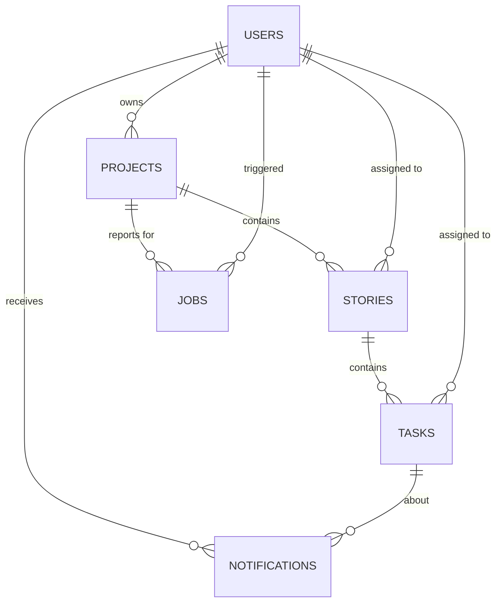

# Sprintboard - Agile Project Management Tool

A full-stack web app for a small team (3-10 people) to run work in a simple agile flow:

**Project -> User Story -> Task**, with assignments, due dates, a kanban-style board, in-app notifications and
a **durable background-job system** (assignment notifications, due-date reminders, report generation) with
retries, exponential backoff and dead-lettering.

> Built for the KPIT Full-Stack Intern assignment. Walkthrough video: `demo/walkthrough.mp4` (see [Demo](#demo)).

| | |
|---|---|
| **Frontend** | Plain HTML/CSS/JS single-page app (no build step), served by the backend |
| **Backend** | Python 3.10+ / FastAPI / SQLAlchemy 2 / Pydantic v2 |
| **Database** | SQLite (WAL mode, foreign keys enforced) |
| **Async** | In-process asyncio worker over a DB-backed job queue |
| **Auth** | JWT bearer tokens, scrypt password hashing |
| **Tests** | pytest - 11 tests (API, business rules, retry/dead-letter, idempotency) |

---

## Quick start

```bash
git clone <this-repo> && cd agile-tracker
python -m venv .venv && source .venv/bin/activate      # Windows: .venv\Scripts\activate
pip install -r requirements.txt
uvicorn app.main:app --reload
```

* App: <http://localhost:8000>  (create an account on the sign-in screen)
* Interactive API docs (Swagger UI): <http://localhost:8000/docs>   ReDoc: <http://localhost:8000/redoc>
* Static OpenAPI spec: [`docs/openapi.json`](docs/openapi.json)
* Run tests: `python -m pytest -q`

The SQLite file `agile.db` is created automatically on first start. Configuration is via environment variables
(see [`.env.example`](.env.example)); every value has a sensible default for local use. Set `SECRET_KEY` to keep
logins valid across restarts (otherwise a random key is generated per run).

**Try it with two users** (to see assignment notifications): register a second account in a private window,
then assign a task to that person from the first account.

**See the retry logic live:** `DELIVERY_FAILURE_RATE=0.7 uvicorn app.main:app` makes the simulated e-mail
provider fail 70% of the time. Assign a few tasks and watch the worker log retries with backoff (and, rarely,
a job going `dead`).

---

## Features

* Create / view / edit / delete **projects, user stories and tasks**; archive projects (archived = read-only).
* Whole hierarchy in one call: `GET /api/projects/{id}` returns Project -> Stories -> Tasks with progress counts.
* **Board view**: stories grouped into Backlog / In progress / Done; filter by assignee and priority;
  expand a story to manage its tasks; move work between states from the card.
* Story priority, story points, assignee; task assignee, due date, status, description.
* **Workflow rules** (enforced server-side, not just in the UI):
  * A story can only be set to *Done* when all its tasks are done (`409` otherwise).
  * Starting a task automatically moves a *Backlog* story to *In progress*.
  * Only the project owner can delete a project; archived projects reject changes (`409`).
* **Notifications** bell with unread count (polls every 8 s).
* **Reports**: "Generate report" queues a background job; the UI polls the job and shows completion %, story/task
  breakdowns, story points, workload per person and overdue tasks.
* "My tasks" endpoint (`GET /api/tasks/mine`) for a personal cross-project view.

---

## Architecture

```
 Browser (vanilla JS SPA)
     |  JSON over HTTP + Bearer JWT
     v
 FastAPI app  -- routers: auth, projects, stories, tasks, notifications, jobs
     |   \  (validation: Pydantic schemas; business rules: services.py)
     |    \
     |     +--> writes domain change + Job row in ONE transaction  (transactional outbox)
     v                                   |
  SQLite  <------------------------------+
     ^
     |  claim job atomically -> run handler -> succeed / retry / dead
 Background worker (asyncio task started in FastAPI lifespan)
     handlers: notify_assignment | due_soon_scan | project_report
```

```
app/
  main.py          app factory, lifespan (creates tables, starts worker), security headers, static files
  config.py        env-based settings
  database.py      engine/session, SQLite pragmas (foreign_keys, WAL)
  models.py        SQLAlchemy models + constraints + indexes
  schemas.py       Pydantic request/response models (all input validation)
  security.py      scrypt hashing, JWT, login rate limiter
  deps.py          current_user dependency
  services.py      shared business rules/helpers
  worker.py        job queue, handlers, retry policy, worker loop
  routers/         auth.py projects.py stories.py tasks.py notifications.py jobs.py
  static/          index.html style.css app.js
tests/             pytest suite (drives the worker deterministically via run_one())
docs/openapi.json  exported API spec
```

---

## Database schema

SQLite, created from the SQLAlchemy models (`Base.metadata.create_all`). Foreign keys are enforced
(`PRAGMA foreign_keys=ON`) and the hierarchy uses `ON DELETE CASCADE`.



| Table | Key columns | Notes |
|---|---|---|
| `users` | `id`, `email` (unique), `name`, `password_hash`, `created_at` | scrypt hash, never returned by the API |
| `projects` | `id`, `name`, `description`, `status` (`active`/`archived`), `owner_id` -> users | `CHECK` on status |
| `stories` | `id`, `project_id` -> projects (CASCADE), `title`, `description`, `status` (`backlog`/`in_progress`/`done`), `priority` (`low`/`medium`/`high`), `points`, `assignee_id` -> users (SET NULL), `position` | index `(project_id, status)` |
| `tasks` | `id`, `story_id` -> stories (CASCADE), `title`, `description`, `status` (`todo`/`in_progress`/`done`), `assignee_id` -> users (SET NULL), `due_date`, `position`, `completed_at` | indexes `(story_id, status)`, `due_date` |
| `notifications` | `id`, `user_id` -> users (CASCADE), `type`, `message`, `task_id` (SET NULL), `dedupe_key` (**unique**), `read`, `delivered_at` | `dedupe_key` makes job retries idempotent |
| `jobs` | `id`, `type`, `payload` (JSON), `status` (`pending`/`running`/`succeeded`/`dead`), `attempts`, `max_attempts`, `run_at`, `locked_at`, `last_error`, `result` (JSON), `unique_key` (**unique**), `project_id` (CASCADE), `created_by` | index `(status, run_at)` for the poller |

All timestamps are stored as naive UTC. `CHECK` constraints keep enum columns valid even if data is written
outside the API.

---

## API overview

Full, always-current documentation with request/response schemas and a "Try it out" console lives at
**`/docs`** (Swagger UI). In Swagger click **Authorize** and paste the `access_token` from `POST /api/auth/login`.

| Area | Endpoints |
|---|---|
| Auth & users | `POST /api/auth/register` - `POST /api/auth/login` - `GET /api/auth/me` - `GET /api/users` |
| Projects | `GET/POST /api/projects` - `GET/PATCH/DELETE /api/projects/{id}` (GET returns the full tree) |
| Stories | `GET/POST /api/projects/{id}/stories` (filters: `status`, `priority`, `assignee_id`) - `GET/PATCH/DELETE /api/stories/{id}` |
| Tasks | `GET/POST /api/stories/{id}/tasks` (filters: `status`, `assignee_id`) - `GET/PATCH/DELETE /api/tasks/{id}` - `GET /api/tasks/mine` |
| Notifications | `GET /api/notifications` - `POST /api/notifications/{id}/read` - `POST /api/notifications/read-all` |
| Jobs & reports | `POST/GET /api/projects/{id}/reports` - `GET /api/jobs` - `GET /api/jobs/{id}` - `POST /api/jobs/due-scan` |
| Meta | `GET /api/health` |

**Conventions:** JSON everywhere; `201` on create, `204` on delete, `202 Accepted` for queued work;
errors are `{"detail": ...}` with `401` (no/invalid token), `403` (not owner), `404`, `409` (business-rule
conflict), `422` (validation), `429` (rate limited). `PATCH` is a true partial update - an explicit `null`
clears only nullable fields (`assignee_id`, `points`, `due_date`).

Example:

```bash
TOKEN=$(curl -s localhost:8000/api/auth/login -H 'content-type: application/json' \
        -d '{"email":"me@example.com","password":"password123"}' | python -c 'import sys,json;print(json.load(sys.stdin)["access_token"])')
curl -s localhost:8000/api/projects -H "Authorization: Bearer $TOKEN" -H 'content-type: application/json' -d '{"name":"Website"}'
curl -s -X POST localhost:8000/api/projects/1/reports -H "Authorization: Bearer $TOKEN"     # -> 202 {"id": 7, "status": "pending", ...}
curl -s localhost:8000/api/jobs/7 -H "Authorization: Bearer $TOKEN"                          # poll until "succeeded"
```

---

## Async / background workflow

Three job types run through one small durable queue (`jobs` table) processed by an asyncio worker that starts
with the app:

| Job | Triggered by | What it does |
|---|---|---|
| `notify_assignment` | assigning a task to someone else | creates an in-app notification, then "sends an e-mail" (simulated provider) |
| `due_soon_scan` | scheduler, hourly (also `POST /api/jobs/due-scan`) | notifies assignees of tasks overdue / due within 24 h, once per task+date |
| `project_report` | `POST /api/projects/{id}/reports` | aggregates the project (status counts, points, workload, overdue) into a stored JSON result |

**Design**

1. **Transactional outbox.** The API writes the job row in the *same* DB transaction as the change that caused
   it. Either both exist or neither does - no "task assigned but notification lost" and no "notification for a
   rolled-back change".
2. **Request path stays fast.** Endpoints only enqueue and return (`202` for reports). The client polls
   `GET /api/jobs/{id}`.
3. **Atomic claiming.** A worker claims a job with `UPDATE jobs SET status='running' ... WHERE id=? AND
   status='pending'`; only one worker can win, so it is safe even with several worker processes.

**Failure handling and retries**

* A handler exception -> the job goes back to `pending` with `run_at = now + base * 2^(attempt-1) + jitter`
  (2 s, 4 s, 8 s by default) and the error is stored in `last_error`. Visible in the UI's report dialog and in
  `GET /api/jobs`.
* After `JOB_MAX_ATTEMPTS` (default 4) the job becomes **`dead`** (dead-letter): kept for inspection and never
  retried automatically. `PermanentError` (e.g. project deleted) skips retries and goes straight to `dead`.
* **Idempotency (at-least-once delivery):** notifications carry a unique `dedupe_key`. In
  `notify_assignment` the in-app notification is committed first, and only the flaky e-mail step is retried,
  so a retry can never create a duplicate or re-send an already delivered e-mail. Due-date reminders use
  `due:{task}:{date}:{user}` so the hourly scan never repeats itself.
* **Crash recovery:** jobs stuck in `running` longer than `STALE_LOCK_SECONDS` (worker killed mid-job) are
  re-queued by the maintenance step. Handlers re-check state (e.g. task re-assigned or deleted -> job is skipped).
* **Scheduling without a scheduler:** the worker enqueues `due_soon_scan` using `unique_key =
  due-scan:{hour-window}`; the unique constraint guarantees one scan per window even with several workers.
* Verified by tests: retry-then-success without duplicates, dead-lettering after max attempts, idempotent scans.

---

## Design decisions and trade-offs

| Decision | Why | Trade-off / what changes at scale |
|---|---|---|
| **SQLite + WAL** | Zero setup, allowed by the brief, fine for a 3-10 person team | One writer at a time; move to PostgreSQL for more concurrency (SQLAlchemy keeps this a config change) |
| **DB-backed job queue instead of Celery/Redis** | Durable, transactional with the data (outbox), no extra infrastructure to run for a reviewer | Polling (1 s) instead of push; throughput limited. Swap for Celery/RQ/SQS behind the same `enqueue()` |
| **In-process worker** | `uvicorn app.main:app` starts everything | If the web process dies the worker stops; run `WORKER_ENABLED=0` web + a separate worker process in production |
| **Team-wide access** (every member sees every project) | Matches "small team" scope and keeps the model simple | No per-project membership/roles. Next step: `project_members` table + role checks |
| **Server-side workflow rules** (story-done rule, archive lock) | Rules hold for every client, not just this UI | A little more logic in the API layer; kept in one place (`services.py`, routers) |
| **Computed progress via eager loading** (`selectinload`) | Simple, correct, no denormalised counters to keep in sync | Loads tasks for list views; fine at this scale, would become SQL aggregates for large projects |
| **Vanilla JS, no framework/bundler** | Nothing to install or build; reviewer runs one command | Manual DOM code; a React/Vue app would scale better for a large UI |
| **`create_all` instead of migrations** | Fastest path for a demo | Add Alembic before any schema change in a real deployment |
| **Integer `position` for ordering** | Simple, explicit | No drag-and-drop reordering endpoint yet; fractional/LexoRank ordering would avoid renumbering |

---

## Security considerations

* **Passwords:** hashed with scrypt (random 16-byte salt, constant-time comparison); never stored or returned in plain text.
* **Auth:** short-lived signed JWTs (HS256, algorithm pinned on decode, 8 h default). Every `/api` route except
  register/login/health requires a valid token. `SECRET_KEY` comes from the environment.
* **Anti-enumeration:** login returns the same `401` for unknown e-mail and wrong password and spends equal hashing time.
* **Brute-force protection:** sliding-window rate limit on login/register (10 per minute per IP+e-mail). In memory, so per process - use Redis when scaling out.
* **Authorization:** project deletion restricted to the owner; notifications are scoped to their recipient (`404`, not `403`, so other users' ids are not revealed); jobs visible to their creator (reports are team-visible).
* **Input validation:** strict Pydantic schemas (lengths, enums, ranges, e-mail pattern); unknown assignees rejected; DB `CHECK` and FK constraints as a second line of defence.
* **SQL injection:** all queries go through SQLAlchemy's parameter binding; no string-built SQL.
* **XSS:** the frontend builds DOM nodes with `textContent`/`createTextNode` and never uses `innerHTML` with user data. A strict **Content-Security-Policy** (`default-src 'self'`), `X-Content-Type-Options`, `X-Frame-Options: DENY` and `Referrer-Policy` are sent on every response.
* **Known limitations (documented, not hidden):** the JWT lives in `localStorage` (vulnerable to token theft if an XSS ever slipped through; mitigated by the CSP and safe DOM building - production would use an `HttpOnly; SameSite` cookie plus CSRF protection); open self-registration (would be invite-only in production); no HTTPS here (terminate TLS at a reverse proxy); no token revocation/refresh; no audit log.

---

## Testing

`python -m pytest -q` runs 11 tests against a temporary SQLite database. The worker is driven
deterministically (`worker.run_one()`), with the backoff set to zero, so async behaviour is tested without sleeps:
auth and validation, hierarchy CRUD and cascade delete, owner-only delete, the story-done rule, filters and
archive lock, assignment -> notification, retry-then-success without duplicates, dead-lettering, report
lifecycle and idempotent due-date scans. The UI was additionally exercised end to end in a real browser
(Playwright): register, create project/story/task, assign, rule violation toast, report generation.

---

## AI usage

I used an AI assistant (Claude) as a pair-programmer for this project: to scaffold the FastAPI/SQLAlchemy
structure, draft the job-queue design, generate the first version of the frontend and tests, and to review
edge cases (idempotency, crash recovery, CSP vs inline styles). I chose the scope and architecture trade-offs,
ran the application and the test suite, exercised the UI in a browser, and fixed the issues found (e.g. an
inline-style attribute being blocked by the CSP, and a falsy value leaking into the DOM). I can explain every
part of the code and the reasoning behind these design choices.

---

## What I would improve or build next

1. **Project membership and roles** (owner / member / viewer) with per-project authorization.
2. **PostgreSQL + Alembic migrations**, and a separate worker process (or Celery/RQ) with a real e-mail provider (SMTP/SES) and webhooks/Slack.
3. **Drag-and-drop board** with a reorder endpoint (fractional ordering), plus sprints/iterations, burndown chart and story-point velocity.
4. **Comments, activity log and file attachments** on stories/tasks; @mentions that generate notifications.
5. **Real-time updates** via Server-Sent Events/WebSocket instead of polling.
6. **Security hardening:** HttpOnly cookie sessions + CSRF, refresh tokens/revocation, invite-only sign-up, Redis-backed rate limiting, audit log.
7. **Observability:** structured logging, job dashboard with manual "retry dead job", metrics (queue depth, failure rate).
8. **Frontend:** migrate to React + TypeScript with component tests and Playwright e2e in CI; accessibility audit; dark mode.
9. **CI/CD:** GitHub Actions (lint, tests), Dockerfile + one-command deploy.

---

## Demo

* Walkthrough video (screen recording with voice narration): [`demo/walkthrough.mp4`](demo/walkthrough.mp4)
* Suggested tour: sign in -> create project -> add story -> add task assigned to a teammate -> open their
  notifications -> try marking the story *Done* (rule blocks it) -> generate a report (async job) -> `/docs`.
